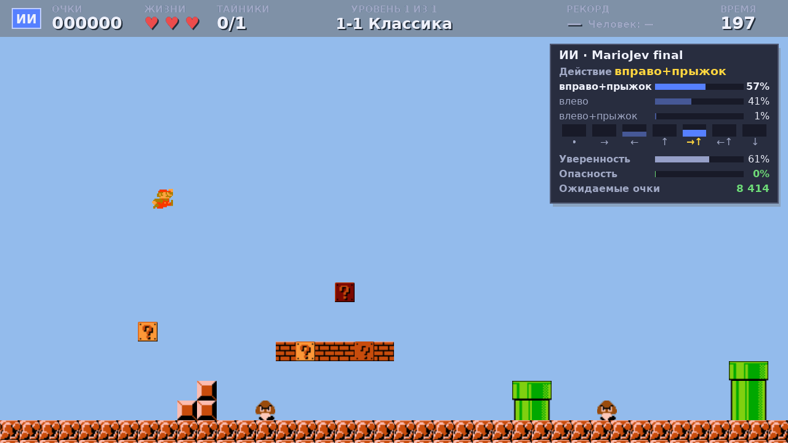

# Mario AIbro

Клон Super Mario Bros на [arcade](https://api.arcade.academy/) с редактором уровней — и нейросеть
**MarioJev**, которая сама проходит уровни. Главное правило: **побеждает не тот, кто прошёл, а тот,
кто набрал больше очков** — поэтому нейросеть учится именно набирать очки, а не просто бежать к флагу.



## Запуск

```bash
python3.12 -m venv .venv
.venv/bin/pip install -r requirements.txt
.venv/bin/python main.py
```

Меню: **ИГРАТЬ** — самому с первого уровня, **ИИ** — нейросеть проходит все уровни подряд,
**УРОВНИ** — выбор уровня и рекорды «человек против ИИ», **РЕДАКТОР УРОВНЕЙ**.
Управление: ←/→ или A/D, прыжок — Space/↑/W, пауза — Esc.

## Очки

| Что | Очки |
|---|---|
| Монета | 100 |
| Удар по блоку «?» снизу (1–4 удара в блоке) | 100 за удар |
| Враг (Goomba — прыжок сверху; Koopa — два прыжка) | 100 |
| Флагшток: чем выше схватился — ≥95 % / ≥70 % / ≥45 % / ≥20 % / ниже | 5000 / 2000 / 800 / 400 / 100 |
| Вход в замок: за каждую оставшуюся секунду | 20 |

Уровень заканчивается как в оригинале: прыжок на флагшток → съезд вниз → Марио идёт в замок.
Смерть (яма, враг, время) оставляет набранные очки, но без флага и бонуса за время.

## Уровни

| Уровень | Что в нём |
|---|---|
| 1-1 Классика | Уровень из редактора — копия первого уровня Super Mario Bros |
| Разминка | Учит прыжкам: дорожки монет показывают траекторию; с лестницы можно взять верх флага |
| Коридор гумб | Группы Goomba и Koopa — очки за каждого растоптанного; безопасный коридор и рискованная крыша |
| Трубы и ямы | Трубы разной высоты, ямы 2–4 тайла, монеты над ямами — для смелых |
| Небесный мост | Длинные пропасти и цепочки парящих платформ, монеты в воздухе |
| Сокровищница | Блоки «?» и монеты над ямами: чем жаднее, тем опаснее |

Уровни проверяются на проходимость (`python -m tools.level_check --all`), а для обучения есть
процедурный генератор (`python -m ai.levelgen --seed 3 --difficulty 0.7 --ascii`).

## Нейросеть MarioJev: какая модель

Модель решений в духе [Jev](https://en.wikipedia.org/wiki/Jev_(AI_model)) — она не пишет текст, а
отвечает на **типизированные вопросы вероятностями**:

- **choice** — какое нажатие сейчас: стоять / вправо / влево / прыжок / вправо+прыжок / влево+прыжок;
- **noul** — вероятность погибнуть в ближайшие 2 секунды;
- **score** — сколько очков ещё будет набрано до конца уровня (распределение по диапазонам).

Эти ответы видно в игре на панели ИИ справа.

**Что видит модель** — не картинку, а то же, что внимательный игрок (`ai/features.py`):
- карта тайлов вокруг Марио — 8 каналов × 16 × 24 (стены, «?» с числом оставшихся ударов, монеты,
  Goomba, Koopa, панцири, флагшток, замок), 4 тайла назад и 19 вперёд;
- до 8 ближайших врагов с точными координатами и скоростью;
- вектор игрока: скорость, опора, жизни, время, где флагшток и как высоко до его верха, прошлое действие.

**Устройство** (`ai/model.py`, 331 тыс. параметров): карта режется на патчи 4×4 → 24 токена, плюс
токен на каждого врага, токен игрока и CLS → трансформер из 3 слоёв (d=96, 4 головы внимания) → четыре
головы: действие, ценность (для обучения), опасность, очки. Решение — 15 раз в секунду (раз в 4 кадра),
~3 мс на процессоре.

Живая игра и обучение крутят один и тот же мир `core/world.py` с фиксированным шагом 1/60 с:
модель в окне видит ровно то, на чём училась (прогон через обучение и через игру совпадает кадр в кадр).

## Как обучалась

**Метод — PPO** (обучение с подкреплением) по реальным исходам игры, как у RLCD в Jev:

| Награда | |
|---|---|
| Очки игры (монеты, блоки, враги, флаг, бонус за время) | очки / 100 |
| Продвижение — только за новый максимум | 30 за весь уровень |
| Потеря жизни / смерть | −3 / −10 |

- **Уровни.** Каждый эпизод — новый процедурный уровень (заучить нельзя, приходится уметь играть);
  сложность растёт по учебному плану до максимума. 30 % эпизодов — уровни «Коридор гумб» и «Трубы и ямы».
- **Отложенные уровни.** 1-1, «Разминку», «Небесный мост» и «Сокровищницу» модель **не видела** ни при
  обучении, ни при выборе лучшего чекпойнта — на них проверялось, что она умеет играть, а не помнит уровень.
- **Итоговая цепочка:** 133 тыс. шагов с нуля → +275 тыс. с большим шагом оптимизатора → +1.54 млн
  с обновлением весов на видеокарте. Всего **1.94 млн решений ≈ 7.8 млн кадров ≈ 36 часов игры**;
  на ПК (Ryzen 5 7500F + GTX 1050 Ti) это заняло около 1.5 часа.
- **Гиперпараметры:** γ=0.97, λ=0.95, lr 7e-4, обрезка градиента 2.0, энтропия 0.02 → 0.005,
  5 параллельных сред × 256 шагов на обновление, минибатч 1024, 4 эпохи.
- **Калибровка** после обучения (`ai/calibrate.py`): голова «очки» и температуры подобраны на полных
  эпизодах так, чтобы «10 %» значило 10 %.

Пять итераций, что в них сломалось и почему выбраны именно эти настройки — в
[docs/ITERATIONS.md](docs/ITERATIONS.md). Коротко: на первых итерациях политика схлопывалась в
«жми вправо+прыжок наугад» — помогли награда за продвижение вместо потенциальной, меньший γ, больший шаг
оптимизатора и перенос обновления весов на видеокарту (×6 быстрее).

## Результат

Турнир — каждый участник проходит все 6 уровней (со случайностью — по 5 раз), считается сумма очков:

| Участник | Сумма очков | На отложенных уровнях | Пройдено уровней |
|---|---|---|---|
| **MarioJev** (`ai/models/mariojev_final.pt`) | **49 820** | **25 620** | 4 из 6 |
| Эвристика (бежит и прыгает перед препятствием) | 21 980 | 16 180 | 3 из 6 |
| Прыгун (всегда «вправо+прыжок») | 19 300 | 7 880 | 2 из 6 |
| Случайные нажатия | 1 760 | 1 560 | 0 |
| [Laya](https://github.com/NandhaKishorM/laya) — открытая альтернатива Jev без дообучения | 700 | 600 | 0 |

MarioJev проходит 1-1, «Разминку», «Коридор гумб» и «Трубы и ямы» в 5 из 5 попыток; на «Небесном мосту»
и в «Сокровищнице» пока гибнет в пропасти, но набирает там 6 400 и 2 300 очков.

Laya — универсальная модель решений (421 млн параметров), обученная на деловых задачах: по текстовому
описанию сцены она в 97 % случаев жмёт «вправо» и застревает у первого препятствия, а решение занимает
~470 мс на видеокарте при бюджете игры 66 мс. Для управления в реальном времени нужна модель,
обученная на самой игре.

## Обучить заново и проверить

```bash
# обучение (на машине с видеокартой NVIDIA: --device cuda)
.venv/bin/python -m ai.train --name my --steps 2000000 --envs 10 --gamma 0.97 --lr 7e-4 \
    --max-grad-norm 2.0 --ent 0.02 --ent-final 0.005 --mix 0.7
.venv/bin/python -m ai.calibrate --model ai/models/my_best.pt --out ai/models/my_final.pt
.venv/bin/python -m tools.tournament --model ai/models/my_final.pt --runs 5
```

Игра в режиме «ИИ» берёт самый свежий `ai/models/*_final.pt`. Проверки интерфейса без окна:
`python -m tools.check_ui --no-draw`.

## Устройство проекта

| Папка | Что внутри |
|---|---|
| `core/` | Мир уровня без окна: физика, враги, очки, флагшток, замок, таймер; манифест уровней |
| `ui/`, `game.py`, `main_menu.py` | Живая игра поверх мира: HUD, итоги уровня, рекорды, выбор уровня, панель ИИ |
| `ai/` | Нейросеть: признаки, модель, среда, обучение, калибровка, контроллер, генератор уровней ([ai/README.md](ai/README.md)) |
| `tools/` | Турнир, проверка уровней, ASCII-рендер уровней, бот-эвристика, проверки интерфейса |
| `maps/` | Уровни и `levels.json` — порядок и какие уровни идут в обучение |
| `docs/` | [Итерации обучения](docs/ITERATIONS.md), [контракт модулей](docs/CONTRACT.md), снимки экранов |
